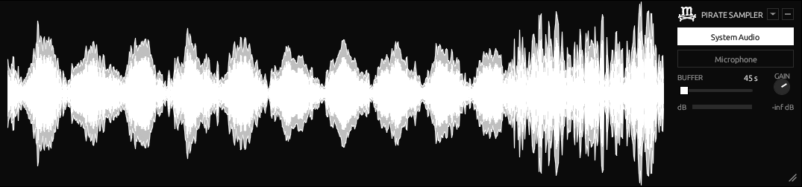

# Pirate Sampler

The tinted metal texture is adapted from [Audio knobs, button, sliders etc.](https://opengameart.org/content/audio-knobs-button-sliders-etc) by Osmic, licensed under [CC BY 3.0](https://creativecommons.org/licenses/by/3.0/).

Knob, pushbutton and fader graphics are from [TeragonGuiComponents](https://github.com/teragonaudio/TeragonGuiComponents) by Max Rudberg and Teragon Audio, under [CC BY-SA 3.0](https://creativecommons.org/licenses/by-sa/3.0/). The knob filmstrip and pushbuttons are used unmodified; the slider thumb is rotated 90° to suit a horizontal fader. Any adapted artwork is likewise licensed under CC BY-SA 3.0.

Linux-first **standalone** rolling ring-buffer sampler, written in Rust.



Clean-room implementation driven only by [`SPEC.md`](./SPEC.md). Not derived from any proprietary binary.

## Target: standalone first

The standalone binary (`target/release/pirate-sampler`) is the supported product and the only
target behaviour is defined against: it captures the desktop monitor over PipeWire, owns its
window (frameless chrome, always-on-top), and drags clips straight into a DAW.

The `Vst3Plugin` implementation in `crates/pirate-sampler/src/lib.rs` is **kept on purpose** so the
plugin can be loaded in a host later, and it must keep compiling — but it is dormant, not shipped
or supported. Desktop routing and frameless window handling only exist in the standalone, and host
state/automation is not wired up. Do not build host-specific features without a concrete need.

## Features (v1)

- Fixed-length stereo **ring buffer** (oldest overwritten)
- Buffer length **30 s … 10 min** (default 45 s)
- Transparent **pass-through** in the VST3 build; the standalone mutes unplayed output so a monitored capture cannot feed back into itself
- **Pause** recording
- **Playback**: right-click loops a selection or plays the whole capture once; playback freezes recording
- **Live loop resize and scrub**: drag a brace edge while looping, or drag outside the brace to scrub under it
- **Playback gain**: -60 … +24 dB, smoothed, playback only
- **Remembers its last window size** between launches
- Waveform GUI with region select + **Export WAV** (32-bit float, host sample rate)
- Reported latency: **0 samples**

## Controls

- **Left-drag** outside a brace: create a selection.
- **Press inside the brace and drag**: drag the clip into a DAW (no nested selection).
- **Drag a brace edge**: resize; a running loop follows live.
- **Right-click**: toggle playback (a selection loops; otherwise the capture plays once).
- **Drag outside a loop brace**: scrub the captured audio under the fixed loop.
- **Right-drag**: pan; **scroll**: zoom; **Esc**: clear the selection.

## Workspace

| Crate | Role |
|-------|------|
| `pirate-sampler-dsp` | Framework-free ring buffer + WAV export + unit/offline tests |
| `pirate-sampler` | nih-plug plugin core + egui editor; runs as the standalone app (VST3 impl kept dormant) |
| `xtask` | Bundle helper (`cargo xtask bundle pirate-sampler --release`) |

## Build (Linux)

For a complete fresh-machine installation — system packages, a user-local install, a desktop
launcher, update, and uninstall — see [`INSTALL.md`](./INSTALL.md).

From the repository root:

```bash
cargo test
cargo build --release -p pirate-sampler
```

Standalone binary: `target/release/pirate-sampler`

## Audio setup on a new Linux machine

Standalone routing needs a running PipeWire session with its JACK and Pulse compatibility layers,
plus `pw-link` and `pactl`. The app follows the system default sink; it has no output picker.

For a read-only check:

```bash
bash .agents/skills/pirate-sampler-audio-setup/scripts/diagnose.sh
```

The matching agent skill (`.agents/skills/pirate-sampler-audio-setup/SKILL.md`) covers capture,
playback, microphone, and wrong-sink problems. It only changes system settings after confirmation.
Ask your coding agent to "set up Pirate Sampler audio" on the new machine.

### Optional VST3 bundle (dormant)

Not part of the normal build or verification — only build it when touching the `Vst3Plugin` path.

```bash
cargo xtask bundle pirate-sampler --release
cp -r target/bundled/pirate-sampler.vst3 ~/.vst3/
```

## Real-time safety

See [`REALTIME.md`](./REALTIME.md).

## CI guidance

See [`.github/workflows/ci.yml`](./.github/workflows/ci.yml).

## License

GPL-3.0-or-later (compatible with nih-plug).
